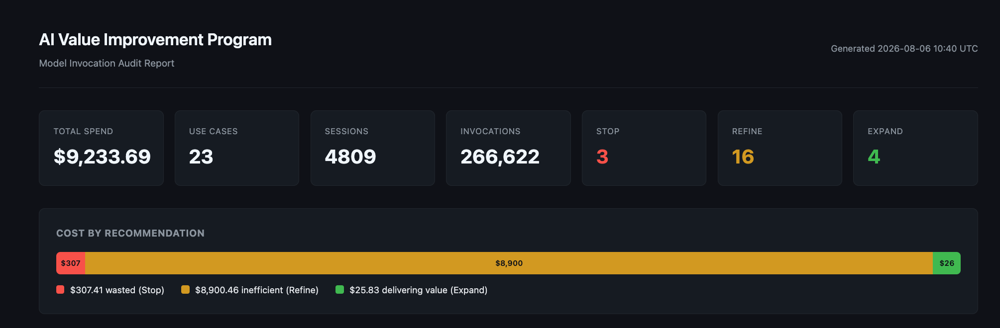
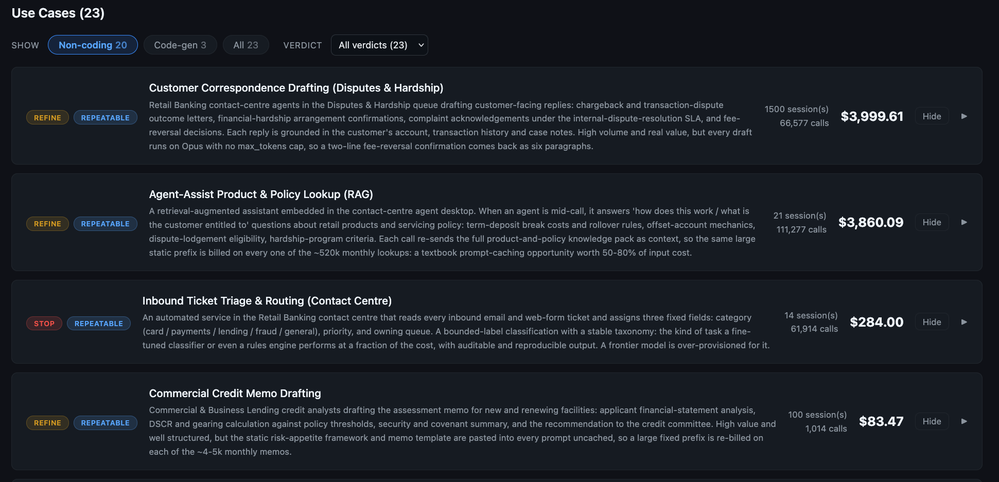
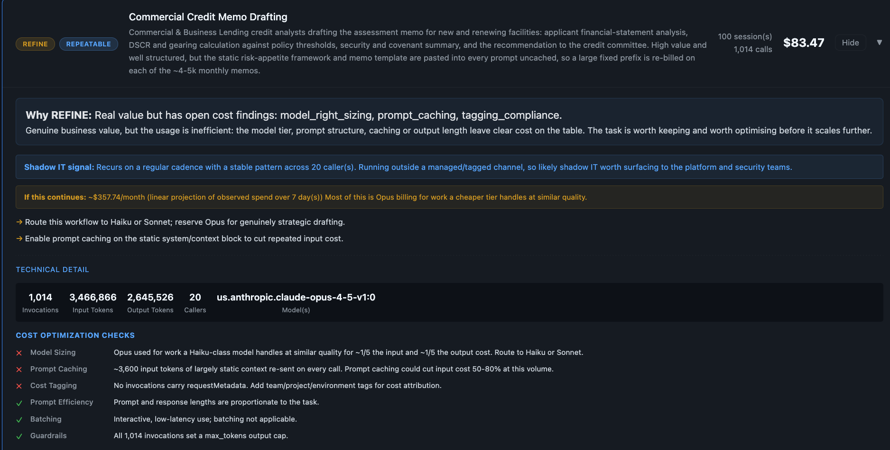

# AI Value Assessment

AI Value Assessment reads your AI usage logs and produces a report that, for
each business use case in those logs, recommends whether to **STOP**, **REFINE**,
or **EXPAND** it, and labels it as a one-off experiment or a recurring workflow.

It supports two log source formats:
- **Bedrock Model Invocation Logs** (default): captures every Bedrock call
  regardless of source (Claude Code, Codex, Amazon Q Developer, LibreChat, or a
  plain SDK script).
- **OpenTelemetry (OTLP) JSON**: captures telemetry from tools like Claude Code
  and Claude Cowork via an OpenTelemetry Collector writing to S3.

It classifies the business task behind each call, not the tool that made it.

You run it with your own AWS credentials, from a laptop or AWS CloudShell. It
reads your logs, calls Bedrock in your account to classify them, and writes the
report to local disk or an S3 bucket. It creates no AWS resources. A
CloudFormation stack is also available if you prefer a one-click run.

## Example output

*Generated from a synthetic Financial Services dataset.*







## Run with your AI

Give this prompt to an AI coding assistant with access to your AWS
credentials (for example Claude Code or Kiro):

```text
Run the AI Value Assessment (https://github.com/aws-samples/sample-ai-value-assessment) against the Bedrock Model Invocation Logs in AWS account <ACCOUNT_ID>, region <REGION>, for <FROM_DATE> to <TO_DATE>.

- Install it and run `aiva run` with a config file, as described in the README's "Run it" section.
- Use my current AWS credentials. Do not create or change any AWS resources.
- Run the preflight checks first. If any check fails, stop and tell me what failed and what permission or setting is missing.
- Write the report to <PATH or s3://bucket/key> and give me a short summary of the use cases and their recommendations.
```

## Before you start

1. **Turn on Model Invocation Logging** (one-time, account admin): in the
   Bedrock console under Settings, send logs to an S3 bucket and note the bucket
   and key prefix. Logs only exist from then on, so let a few days of usage
   build up.
2. **Enable the classification model** in Bedrock (default
   `global.anthropic.claude-sonnet-4-6`, or set `model` in the config).
3. **Permissions for the person running it:**

| Needs | When |
|---|---|
| `s3:ListBucket` and `s3:GetObject` on the log bucket, `bedrock:InvokeModel` on the model ([docs/iam-policy.json](docs/iam-policy.json)) | Always |
| `kms:Decrypt` on the bucket's key | The log bucket uses a customer managed KMS key |
| `s3:PutObject` on the output bucket | `output` is an `s3://` path |
| `sts:AssumeRole` on a role in the log account, which trusts your role and can read the bucket | Logs are in another account (config `role_arn`) |

## Where to run it

1. **AWS CloudShell**, in the account and region of the logs. Credentials are
   already set up and nothing is created. Sessions end after about 20 minutes
   idle and home storage is about 1 GB, so it suits a week of a team's or
   department's logs.
2. **A laptop** with your usual AWS credentials (for example `aws sso login`).
   No session limit; use this for large windows.
3. **The CloudFormation stack** ([below](#deploy-with-cloudformation)), if your
   account allows CodeBuild and one source over the last N days is enough.

## Run it

Needs Python 3.11 or later. [uv](https://docs.astral.sh/uv/) installs it if
your machine has an older one.

```bash
pip install --user uv
git clone https://github.com/aws-samples/sample-ai-value-assessment.git
cd sample-ai-value-assessment
uv venv --python 3.11 && source .venv/bin/activate
uv pip install .

cp aiva.example.toml aiva.toml   # set region, from/to dates, buckets and output
aiva run --config aiva.toml
```

Preflight checks credentials, bucket access and model access before anything
is read. The config lists one or more log sources, and they all go into one
report. Every setting is described in [docs/config.md](docs/config.md).

The report (`.html`, `.md` and `.json`) contains real prompt and response
excerpts. Treat it as sensitive: do not commit or share it outside your team.
Pass `--db path/to/audit.db` to keep the working store; re-running into the
same file skips logs already read, so an interrupted run resumes.

For a quick look at one bucket without a config file:

```bash
aiva audit --bucket <log-bucket> --prefix "" --region <region> --days 7
```

## OpenTelemetry sources (Claude Code, Cowork)

aiva reads OpenTelemetry log exports in OTLP JSON, as written to S3 by the
OpenTelemetry Collector's `awss3` exporter with `marshaler: otlp_json`. How the
data gets to S3 is up to you. Setup references:

- Claude Code: [Monitoring usage](https://code.claude.com/docs/en/monitoring-usage)
- Claude Cowork: [Monitoring](https://claude.com/docs/cowork/monitoring) (Team and Enterprise plans)

Once telemetry is switched on, events carry model, tokens and cost, but no
prompt or response text.
For better classification, turn content on: for Claude Code set
`OTEL_LOG_USER_PROMPTS=1`, `OTEL_LOG_ASSISTANT_RESPONSES=1` and
`OTEL_LOG_TOOL_DETAILS=1`; for Cowork set the `otlpContentCapture` device policy.

Then add a source to the config:

```toml
[[sources]]
type = "otlp"
bucket = "my-otel-exports"
prefix = "claude-code/"
```

Only add usage that does not run through Bedrock. Claude Code or Cowork on
Bedrock already appear in the Bedrock logs and would be counted twice.

## Deploy with CloudFormation

The stack runs the audit as a CodeBuild job in your account and writes the
report to an S3 bucket. It needs permission to create CodeBuild, IAM and S3
resources, which some organisations restrict with SCPs; if so, use
[Run it](#run-it) instead.

In the CloudFormation console, create a stack and upload
[`cloudformation/deploy.yaml`](cloudformation/deploy.yaml) as the template.

1. Switch to the same region as your Model Invocation Logs bucket.
2. Set **SourceBucketName** to your log bucket. Optionally set
   **DestinationBucketName**, or leave it blank to have one generated. If the
   log bucket uses SSE-KMS with a customer managed key, set
   **SourceBucketKmsKeyArn**. **ClassifierModelId** takes any Bedrock model ID
   or inference profile ID/ARN (default `global.anthropic.claude-sonnet-4-6`).
   For OpenTelemetry logs set **SourceFormat** to `otlp`.
3. Optionally set **ReportReaderPrincipalArn** to the single IAM identity that
   may read the report. Left blank, any principal in the account can read it.
   Public access is always blocked.
4. Acknowledge the IAM-resources checkbox and create the stack. The audit starts
   when the stack finishes deploying.
5. The report lands in the destination bucket (`DestinationBucketNameOutput`)
   when the CodeBuild project (`AuditProjectConsoleUrl`) finishes.

The stack creates a CodeBuild project, an IAM role scoped to
[`docs/iam-policy.json`](docs/iam-policy.json) plus write to the output bucket,
and the destination S3 bucket (encrypted, public-access blocked, HTTPS-only).

**Cost estimate note:** costs are estimated from token counts and published
model pricing (or, for OpenTelemetry, the cost the tool reports). They do not
reflect negotiated rates, provisioned throughput or batch discounts.

## Reading the report

Each use case carries one recommendation:

- **STOP**: no identifiable task, or work that does not need AI.
- **REFINE**: real value but inefficient (wrong model tier, no caching, bloated prompts).
- **EXPAND**: clear value, efficient, worth scaling.

A separate axis labels each use case **experimental** or **repeatable**. A
repeatable use case running outside sanctioned channels is shadow AI worth
surfacing to your platform or security team.

Cost-optimisation checks (model right-sizing, caching, tagging, output
guardrails) are shown per use case. Cost and monthly projection are computed in
code, not by the model.

Classification is semantic. Treat each recommendation as a starting point for
human review, not automated action.

**Privacy note:** Example tasks shown per use case are model-generated
paraphrases, not verbatim quotes from logs. The model is instructed to
de-identify (remove names, project names, customer names), but this is
best-effort. Review the report before sharing it outside your immediate team.

## How it works

```
S3 logs -> read + parse -> store -> sessions -> Pass 1 -> Pass 2a -> Pass 2b -> report
```

1. **Describe** each session's underlying business task, looking through the
   tool to the real work.
2. **Cluster** activities into distinct use cases by meaning.
3. **Assess** each use case: STOP/REFINE/EXPAND, experimental/repeatable, and
   cost checks.

The components, the diagram, and how memory and cost stay bounded at
organisation scale are in [docs/ARCHITECTURE.md](docs/ARCHITECTURE.md).

## Costs

The audit calls Bedrock a handful of times (roughly one classification call per
session plus a couple of rollup calls) using the classification model. The expensive
Bedrock usage is your existing logs; the tool only reads and summarises them.

The table below is illustrative, not a quote. Cost scales with the number of
distinct sessions, not raw invocation count. Rates are the default classification model,
Sonnet 4.6, at $3.00 per million input tokens and $15.00 per million output.

| Log volume (1 week) | Objects / invocations | Distinct sessions | Approx cost to run |
|---------------------|-----------------------|-------------------|--------------------|
| Small team          | ~1,000                | ~20               | a few cents        |
| Department          | ~20,000               | ~400              | ~$1-3              |
| Org-wide            | ~200,000              | ~4,000            | ~$20-40            |

The middle row is close to a real one-week run measured during development.
Actual cost depends on prompt sizes and how many sessions your logs contain,
so treat these as order-of-magnitude.

## Cleanup

CloudFormation deploy: delete the stack in the CloudFormation console (or
`aws cloudformation delete-stack --stack-name <name>`). This removes the
CodeBuild project and IAM role. If you let CloudFormation generate the
destination bucket, empty it first, then it is removed with the stack; a bucket
you named yourself is left in place. There are no other standing resources.

Local run: delete the generated `report.*` files and any `--db` store, and
remove the virtualenv.

## Disclaimer

This is sample code, provided as-is, for demonstration purposes only. It is not
an AWS-supported production tool. Review the IAM policy in
`docs/iam-policy.json` and the code itself before running it against any
account, and test in a non-production environment first.

## Security

See [CONTRIBUTING](CONTRIBUTING.md#security-issue-notifications) for more information.

## License

Licensed under the MIT-0 License. See the `LICENSE` file.
