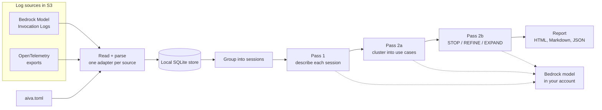
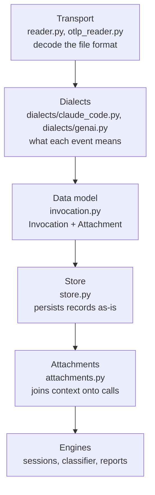

# Architecture

Everything runs in your account with your credentials. Logs are read from S3, the
classification calls go to Bedrock, and the report is written to a local path or
an S3 bucket you choose.

## Components

| Step | Code | What it does |
|---|---|---|
| Config | `aiva/config.py` | Reads `aiva.toml` (see [config.md](config.md)), or the `aiva audit` flags |
| Read | `aiva/ingest.py` | Lists, fetches and decompresses log objects, splits them into JSON documents, skips bad objects, batches rows into the store. Shared by every source |
| Parse | `aiva/reader.py`, `aiva/otlp_reader.py` | One adapter per source turns a JSON document into the data model (`aiva/invocation.py`). Registered in `aiva/sources.py` |
| Dialects | `aiva/dialects/` | For OpenTelemetry, one module per telemetry schema (Claude Code and Cowork, GenAI conventions) decides what each event means |
| Store | `aiva/store.py` | Local SQLite file. Light columns for grouping, full content fetched per session |
| Attachments | `aiva/attachments.py` | Puts context that arrived apart from a call back onto that call when a session is loaded |
| Sessions | `aiva/cli.py` | Groups by an explicit session id, otherwise by caller with a 30 minute gap |
| Classify | `aiva/classifier.py`, `aiva/prompts/` | Three passes, below |
| Report | `aiva/html_reporter.py`, `aiva/reporter.py` | HTML, Markdown and JSON |

The three passes:
1. **Describe** each session's business task, looking past the tool to the work.
2. **Cluster** the activities into use cases by meaning.
3. **Assess** each use case: STOP/REFINE/EXPAND, experimental or repeatable, and cost checks. Costs and monthly projections are computed in code, not by the model.

## Layers

Each layer only knows the one below it, so product-specific rules stay in one
place and the store, sessions and classifier never change when a source is added.

- **Data model.** `Invocation` is one model call and stays small and
  source-neutral. Anything a source reports apart from the call (prompt text,
  response text, tool names) is an `Attachment`, keyed by `prompt_id`. New
  kinds of context are new attachment kinds, not new `Invocation` fields or
  subclasses.
- **Transport.** Decodes a file format (Bedrock log JSON, OTLP JSON) and knows
  nothing about the products that wrote it. Bedrock logs have one schema, so
  `reader.py` covers both transport and dialect.
- **Dialects.** One module per telemetry schema with `matches(event)` and
  `to_record(event)`. Tried in order, first match wins and owns the event,
  including dropping it. Matched by event name, not only `service.name`, since
  `OTEL_SERVICE_NAME` can be changed. The GenAI conventions are last, as the
  fallback. Adding a schema (for example another agent framework) is one
  module and one entry in `aiva/dialects/__init__.py`.
- **Store.** Persists invocations and attachments and returns them. It holds no
  join or product logic.
- **Attachments.** The only place that knows how attachments join onto calls.
  The join happens when a session is loaded, not while parsing, because an
  OpenTelemetry collector batches by time and a prompt's events can land in
  different S3 objects. The prompt and tool names go on the prompt's first
  call, a response on the call with its `request_id`.
- **Engines.** Sessions, classifier and reporters see only invocations with
  their context filled in.

Only model calls become invocations, so counts and cost are never inflated by
tool, hook or prompt events.

## Memory ceiling

A week of a large organisation's logs holds hundreds of thousands to millions of
invocations, each with tens of KB of prompt and response text. Held as one Python
list that was measured at 12 to 122 GB. So nothing holds the whole window:

- Reads write to the store in batches of 500 rows as objects arrive.
- Grouping uses only the light columns (caller, time, cost, session id).
- Pass 1 fetches one session's full content at a time, at most 8 sessions in parallel.

Peak memory depends on batch size and worker count, not on log volume. Re-running
into the same `--db` skips objects already stored, so an interrupted read resumes.

## Cost model

The audit's own Bedrock cost scales with sessions, not invocations:

- Pass 1: one call per session.
- Pass 2a: one call per 50 activities, plus merge calls across chunks.
- Pass 2b: one call per use case, capped by `max_use_cases` (default 50). Use cases
  past the cap roll into "Other", still counted in totals.

Spend in real organisations concentrates in a few use cases, so the cap rarely
hides anything that matters, and raising it costs cents per extra use case. Every
audit call is tagged `requestMetadata: {"source": "aiva-audit"}` and reported
separately, so a later audit does not count it as customer usage.
