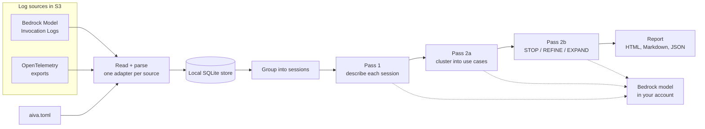

# Architecture

Everything runs in your account with your credentials. Logs are read from S3, the
classification calls go to Bedrock, and the report is written to a local path or
an S3 bucket you choose.

## Components

| Step | Code | What it does |
|---|---|---|
| Config | `aiva/config.py` | Reads `aiva.toml` (see [config.md](config.md)), or the `aiva audit` flags |
| Read | `aiva/ingest.py` | Lists, fetches and decompresses log objects, splits them into JSON documents, skips bad objects, batches rows into the store. Shared by every source |
| Parse | `aiva/reader.py`, `aiva/otlp_reader.py` | One adapter per source turns a JSON document into `Invocation` records (`aiva/invocation.py`). Registered in `aiva/sources.py` |
| Store | `aiva/store.py` | Local SQLite file. Light columns for grouping, full content fetched per session |
| Sessions | `aiva/cli.py` | Groups by an explicit session id, otherwise by caller with a 30 minute gap |
| Classify | `aiva/classifier.py`, `aiva/prompts/` | Three passes, below |
| Report | `aiva/html_reporter.py`, `aiva/reporter.py` | HTML, Markdown and JSON |

The three passes:
1. **Describe** each session's business task, looking past the tool to the work.
2. **Cluster** the activities into use cases by meaning.
3. **Assess** each use case: STOP/REFINE/EXPAND, experimental or repeatable, and cost checks. Costs and monthly projections are computed in code, not by the model.

## Memory ceiling

A week of a large organisation's logs holds hundreds of thousands to millions of
invocations, each with tens of KB of prompt and response text. Held as one Python
list that was measured at 12 to 122 GB. So nothing holds the whole window:

- Reads write to the store in batches of 500 rows as objects arrive.
- Grouping uses only the light columns (caller, time, cost, session id).
- Pass 1 fetches one session's full content at a time, at most 8 sessions in parallel.

Peak memory depends on batch size and worker count, not on log volume. Re-running
into the same `--db` skips objects already stored, so an interrupted read resumes.

## Cost model

The audit's own Bedrock cost scales with sessions, not invocations:

- Pass 1: one call per session.
- Pass 2a: one call per 50 activities, plus merge calls across chunks.
- Pass 2b: one call per use case, capped by `max_use_cases` (default 50). Use cases
  past the cap roll into "Other", still counted in totals.

Spend in real organisations concentrates in a few use cases, so the cap rarely
hides anything that matters, and raising it costs cents per extra use case. Every
audit call is tagged `requestMetadata: {"source": "aiva-audit"}` and reported
separately, so a later audit does not count it as customer usage.
